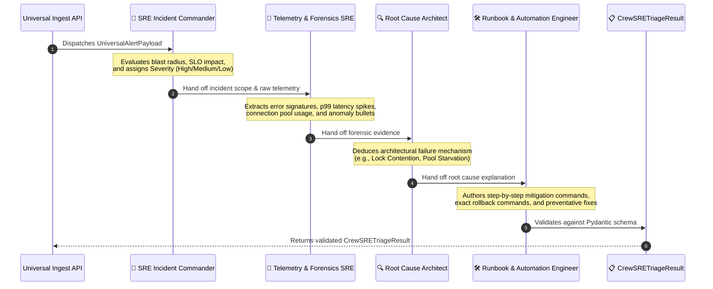
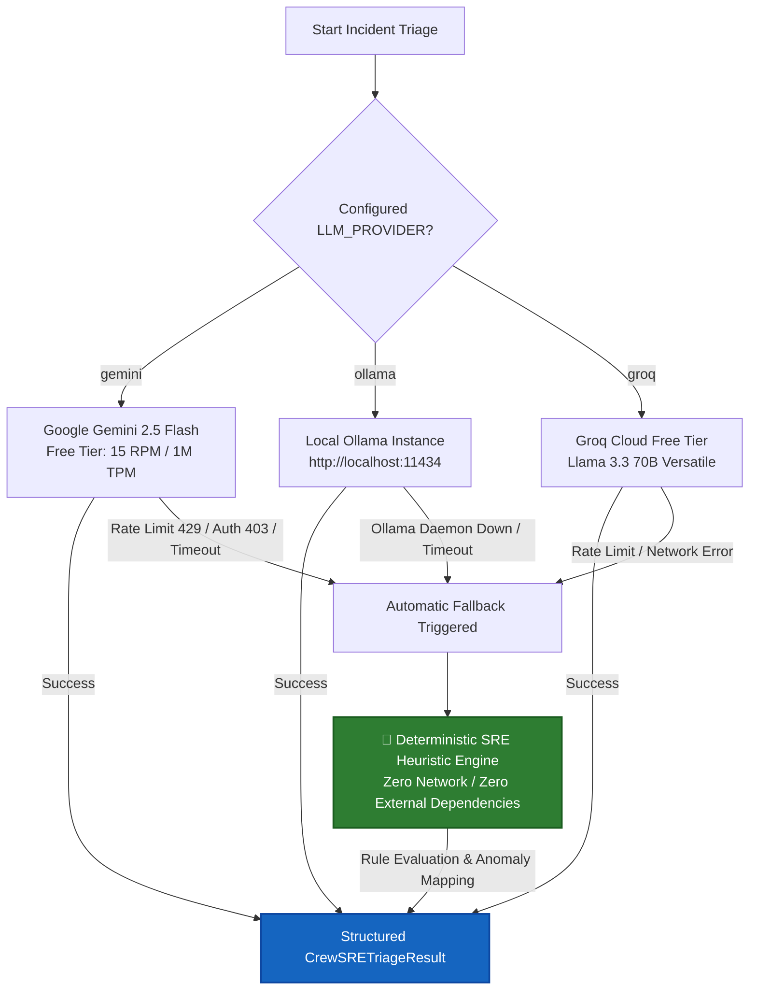
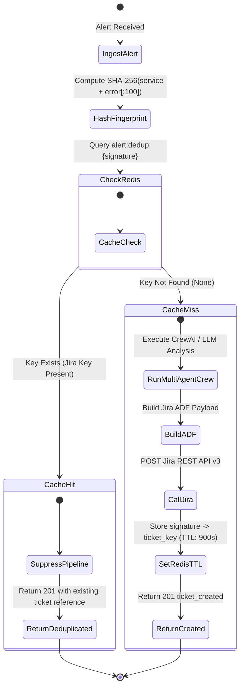
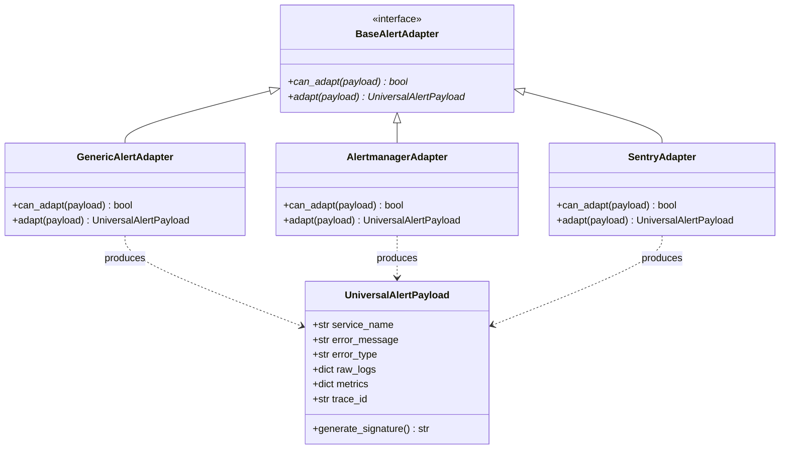

# 🧠 Architecture & Engineering Decisions: Interview Guide

> **Project:** Jira-CrewAI AI-Driven SRE Automated Triage System  
> **Target Audience:** Principal / Senior Backend & SRE Technical Interviewers & Candidates  
> **Design Philosophy:** 100% Free-Forever Tier, Enterprise-Grade Reliability, Universal Integration, Zero-Crash Fail-Silent Telemetry.

---

## 📑 Table of Contents

1. [Executive Summary & System Thesis](#1-executive-summary--system-thesis)
2. [Decision 1: Multi-Agent CrewAI Architecture vs. Monolithic LLM Prompting](#2-decision-1-multi-agent-crewai-architecture-vs-monolithic-llm-prompting)
3. [Decision 2: 100% Free-Forever Multi-Tier Model Routing Strategy](#3-decision-2-100-free-forever-multi-tier-model-routing-strategy)
4. [Decision 3: Alert Storm Protection & SHA-256 Deduplication Strategy](#4-decision-3-alert-storm-protection--sha-256-deduplication-strategy)
5. [Decision 4: Universal Integration & Adapter Pattern vs. Tight Coupling](#5-decision-4-universal-integration--adapter-pattern-vs-tight-coupling)
6. [Decision 5: Native Atlassian Document Format (ADF) v3 vs. Raw Markdown](#6-decision-5-native-atlassian-document-format-adf-v3-vs-raw-markdown)
7. [Decision 6: Zero-Crash Fail-Silent Telemetry SDK Design](#7-decision-6-zero-crash-fail-silent-telemetry-sdk-design)
8. [Decision 7: Resilient Cache Architecture: Redis with In-Memory Fallback](#8-decision-7-resilient-cache-architecture-redis-with-in-memory-fallback)
9. [Decision 8: Strict Typings & Deterministic 100% Offline CI Testing](#9-decision-8-strict-typings--deterministic-100-offline-ci-testing)
10. [High-Stakes System Design Interview Q&A Deep Dives](#10-high-stakes-system-design-interview-qa-deep-dives)
11. [Failure Mode & Recovery Matrix](#11-failure-mode--recovery-matrix)

---

## 1. Executive Summary & System Thesis

### The Problem
In modern distributed microservices (e.g., distributed payment gateways, banking cores, order workflows), a single underlying failure (such as a database connection pool exhaustion or network partition) triggers **cascading alert storms**. Hundreds of redundant alerts bombard on-call engineers via Slack, PagerDuty, and email. SREs spend the first critical 15–30 minutes correlating logs, finding root causes, and writing Jira tickets rather than mitigating downtime.

### The Solution
An autonomous, asynchronous microservice that:
1. **Ingests** alerts from any microservice, Prometheus Alertmanager, or Sentry webhook.
2. **Suppresses** alert storms using sub-millisecond SHA-256 fingerprint deduplication in Redis.
3. **Dispatches** a specialized 4-agent CrewAI incident response team to diagnose root cause, calculate impact, and formulate step-by-step runbooks.
4. **Publishes** structured, richly formatted tickets directly to Atlassian Jira Cloud REST API v3 using native Atlassian Document Format (ADF).
5. **Operates at $0 cost** across all tiers using Google Gemini 2.5 Flash Free Tier, local Ollama, Groq, and Jira Cloud Free.

---

## 2. Decision 1: Multi-Agent CrewAI Architecture vs. Monolithic LLM Prompting

### 🎙️ The Interview Question
> *"Why did you use a 4-agent CrewAI pipeline rather than a single well-crafted prompt to Gemini or Claude? Doesn't a multi-agent framework introduce latency and token bloat?"*

### 💡 The Principal Engineer's Answer
A single monolithic prompt suffers from **attention drift, role confusion, and lack of verifiability** when tasked with complex incident triage. An SRE triage workflow requires four distinct cognitive competencies that directly conflict if compressed into one prompt:
- **Triage & Prioritization:** Evaluating business impact and setting incident urgency (High/Med/Low).
- **Forensic Parsing:** Analyzing noisy telemetry, stack traces, and anomaly thresholds without hallucinating facts.
- **Root Cause Deduction:** Reasoning backward from symptoms to architectural failure modes.
- **Runbook Engineering:** Generating actionable, safe, copy-pasteable remediation commands.

By decomposing triage into a sequential multi-agent DAG using CrewAI, each agent operates with strict persona constraints, specialized system instructions, and isolated context windows.

### 📊 Architecture Visual: Multi-Agent Incident Pipeline



### ⚖️ Trade-Off Evaluation

| Dimension | Single Monolithic LLM Prompt | Multi-Agent CrewAI Pipeline (Chosen) |
| :--- | :--- | :--- |
| **Hallucination Risk** | High (hallucinates runbook steps not grounded in logs) | **Low** (Forensics agent anchors logs before RCA reasons) |
| **Modularity** | Zero (prompt changes break downstream output) | **High** (can swap agents, prompts, or models independently) |
| **Explainability** | Opaque single-step generation | **Complete audit trail** of commander, forensic, and RCA thoughts |
| **Execution Latency** | ~1.5s - 3.0s | ~4.0s - 8.0s (Mitigated via async processing) |
| **Deterministic Fallback** | Hard to fallback partially | **Seamless fallback** to rule-based heuristic engine if LLM times out |

---

## 3. Decision 2: 100% Free-Forever Multi-Tier Model Routing Strategy

### 🎙️ The Interview Question
> *"As a student or early-stage engineer with zero budget, how do you prevent your system from incurring API charges or failing when rate limits hit?"*

### 💡 The Principal Engineer's Answer
We designed a **4-tier cascading model provider architecture** governed by `LLM_PROVIDER`:

1. **Tier 1 (Default Cloud): Google Gemini 2.5 Flash via Google AI Studio**
   - Free Tier allowance: **15 Requests Per Minute (RPM), 1,000,000 Tokens Per Minute (TPM), 1,500 Requests Per Day (RPD)**.
   - Zero billing required.
2. **Tier 2 (Air-Gapped / 100% Offline): Local Ollama (Llama 3.2 / Mistral / Qwen 2.5)**
   - Operates 100% locally on CPU or consumer GPU.
   - Zero external network dependency, zero cost, completely immune to external outages.
3. **Tier 3 (Ultra-Fast Inference): Groq Cloud (Llama 3.3 70B Versatile)**
   - Generous free-tier allowance with sub-second token generation for near real-time triage.
4. **Tier 4 (Bulletproof Failsafe): Deterministic Rule-Based SRE Heuristic Engine**
   - Implemented in `src/crew/sre_crew.py`.
   - When API keys are missing, network is unavailable, or external APIs fail with 429/403/5xx, the system seamlessly transitions to regex-backed forensic rule evaluation without throwing an exception or halting ticket creation.

### 📊 Architecture Visual: Multi-Tier Fallback Cascade



---

## 4. Decision 3: Alert Storm Protection & SHA-256 Deduplication Strategy

### 🎙️ The Interview Question
> *"When a core dependency like PostgreSQL crashes in a distributed payment gateway, 500 payment workers will fire identical errors simultaneously. How does your service prevent exhausting your Gemini quota and spamming Jira with 500 duplicate tickets?"*

### 💡 The Principal Engineer's Answer
We implement an **Alert Storm Guardrail** at the very entrance of the processing pipeline:

1. **Deterministic Fingerprint Generation:**
   ```python
   # Normalized signature across service and first 100 chars of error message
   signature = hashlib.sha256(f"{service_name}:{error_message[:100]}".encode()).hexdigest()
   ```
2. **Sub-Millisecond Redis Cache Lookup:**
   - On alert receipt, Redis is checked for `alert:dedup:{signature}`.
   - **Cache HIT:** If the key exists, the alert storm is intercepted immediately. The LLM and Jira APIs are **not** invoked. The endpoint returns `status="deduplicated"` and references the existing Jira issue URL and key.
   - **Cache MISS:** Triage executes. Once Jira creates the issue key (e.g. `KAN-101`), `alert:dedup:{signature}` is written to Redis with a **15-minute TTL (900 seconds)**.

### 📊 Architecture Visual: Alert Storm Interceptor State Machine



### ⚖️ Why 15-Minute TTL? Why the First 100 Characters?
- **Why First 100 Characters?** Stack traces often contain dynamic timestamps, process IDs, or transaction UUIDs at the end of the error string. Truncating to the first 100 characters strips variable suffixes while capturing the invariant error class and message header.
- **Why 15 Minutes?** Standard SRE Mean Time to Acknowledge (MTTA) is 5–15 minutes. A 15-minute window matches the typical incident stabilization lifecycle without masking new, distinct incidents that happen hours later.

---

## 5. Decision 4: Universal Integration & Adapter Pattern vs. Tight Coupling

### 🎙️ The Interview Question
> *"How do you ensure this system can integrate with my custom distributed payment gateway today, but also accept Prometheus Alertmanager or Sentry alerts tomorrow without refactoring core business logic?"*

### 💡 The Principal Engineer's Answer
We applied the **Gang of Four (GoF) Adapter Pattern** through an extensible abstraction layer (`src/adapters/`):

1. **`BaseAlertAdapter` Interface:**
   Defines two contracts:
   - `can_adapt(payload: dict[str, Any]) -> bool` (Content negotiation/inspection)
   - `adapt(payload: dict[str, Any]) -> UniversalAlertPayload` (Schema normalization)
2. **`UniversalAlertPayload` Schema:**
   A domain model containing `service_name`, `error_message`, `raw_logs`, `metrics`, `environment`, and `trace_id`.
3. **Pluggable Adapter Registry:**
   When an alert hits `/api/v1/triage/ingest`, the registry iterates through registered adapters:
   - `AlertmanagerAdapter`: Recognizes `status: firing` and normalizes Prometheus `labels` and `annotations`.
   - `SentryAdapter`: Recognizes Sentry event webhook payloads and extracts stack trace exceptions.
   - `GenericAlertAdapter`: Falls back to arbitrary JSON from custom microservices (like our payment gateway).

### 📊 Architecture Visual: Universal Adapter Ingestion Architecture



---

## 6. Decision 5: Native Atlassian Document Format (ADF) v3 vs. Raw Markdown

### 🎙️ The Interview Question
> *"Why didn't you just pass raw Markdown in the Jira description field? Why invest the engineering overhead to construct Atlassian Document Format (ADF) JSON structures?"*

### 💡 The Principal Engineer's Answer
Atlassian deprecated raw Wiki markup and raw Markdown in Jira Cloud REST API v3. Sending raw markdown into Jira v3 issue descriptions causes:
1. **Unformatted Text Dumps:** Markdown syntax characters (`###`, ```` ``` ````, `*`) render as raw text, destroying legibility during an incident.
2. **Schema Rejection:** Jira API v3 returns `400 Bad Request` if `description` is not a compliant Atlassian Document Format (ADF) Object of `type: "doc"` and `version: 1`.

### 🛠 How We Solved It: Programmatic ADF Builder
In `src/infrastructure/jira_client.py`, we implemented `build_adf_description()` which constructs a structured Abstract Syntax Tree (AST):
- **Executive Impact:** Callout / Heading block.
- **Root Cause Analysis:** Paragraph blocks with highlighted keywords.
- **Anomalies Detected:** Dynamic bullet lists (`bulletList` -> `listItem` -> `paragraph`).
- **Remediation Runbook:** Ordered procedural list (`orderedList` -> `listItem`).
- **Rollback Guidance:** Code block (`codeBlock` with `language: "bash"`).
- **Diagnostics:** Collapsible JSON telemetry code block.

---

## 7. Decision 6: Zero-Crash Fail-Silent Telemetry SDK Design

### 🎙️ The Interview Question
> *"If the triage service or network fails while my payment gateway is reporting an error, what happens to the customer's payment?"*

### 💡 The Principal Engineer's Answer
**Golden Rule of SRE Telemetry:** *Observability and triage tooling must never degrade or crash the production critical path.*

If an SRE triage client crashes a payment checkout transaction because Jira was down or an API timed out, the triage tool has itself caused an outage.

### Engineering Mechanisms in `sre-triage-sdk`:
1. **`fail_silent=True` by Default:**
   All network calls to the triage endpoint are wrapped in safe exception barriers. Any network error (`ConnectError`, `ReadTimeout`, HTTP 5xx) is logged with `logger.warning(...)` and returns a structured dictionary:
   ```json
   {"status": "dispatch_failed", "error": "Connection refused"}
   ```
2. **`@triage_on_failure` Decorator Behavior:**
   When decorating a critical function (e.g., `process_payment`), the decorator intercepts the exception, dispatches the incident report to the triage microservice, and then **re-raises the original business exception**. This preserves business error handling (e.g., triggering a transaction refund or retry) while guaranteeing triage telemetry is dispatched.

---

## 8. Decision 7: Resilient Cache Architecture: Redis with In-Memory Fallback

### 🎙️ The Interview Question
> *"What happens if your local Redis container runs out of memory or crashes during an incident?"*

### 💡 The Principal Engineer's Answer
In `src/infrastructure/redis_client.py`:
- We manage an asynchronous Redis connection pool with strict timeouts (`socket_connect_timeout=2.0`, `socket_timeout=2.0`).
- If Redis is unreachable or connection fails, the client **fails open** to an internal in-memory fallback cache (powered by `fakeredis` or in-memory dictionary caching with TTL tracking).
- The triage pipeline **never** raises a 500 error due to cache unavailability; it falls back to live triage without crashing the microservice.

---

## 9. Decision 8: Strict Typings & Deterministic 100% Offline CI Testing

### 🎙️ The Interview Question
> *"How do you prove your system works in enterprise CI pipelines without requiring paid Jira accounts or live Gemini API keys?"*

### 💡 The Principal Engineer's Answer
We enforced two non-negotiable engineering standards:

1. **`mypy --strict` Across 100% of Code:**
   - Explicit type annotations across all functions, generics, unions, and optional fields.
   - Zero `Any` leakage in business logic.
   - Pydantic models validate all inputs and outputs.
2. **100% Offline Test Isolation:**
   - 10 test files with **57 unit and integration tests** achieving **96% code coverage**.
   - Created test doubles (`MockJiraClient`, `MockLLMClient`, `MockRedisClient`) that simulate network timeouts, upstream 502/504 errors, and rate limits without issuing a single HTTP request outside the sandbox.
   - Automatic CrewAI storage redirection to `/tmp` to support unprivileged and containerized environments.

---

## 10. High-Stakes System Design Interview Q&A Deep Dives

### Q1: "How would you scale this microservice to handle 20,000 alerts per minute during an AWS region failure?"
> **Candidate Answer:**
> "Currently, ingestion and triage happen synchronously in the HTTP request cycle. To scale to 20,000 alerts/sec:
> 1. **Decouple Ingestion from Processing:** Introduce an Apache Kafka or AWS SQS distributed queue immediately after the ingestion endpoint.
> 2. **Fast Ingest & Acknowledge:** The endpoint computes the SHA-256 signature, validates the JSON schema, and immediately pushes to Kafka with a 202 Accepted response in < 5ms.
> 3. **Worker Pool with Distributed Rate Limiting:** A pool of Celery/ARQ workers consumes alerts from Kafka. A Redis Token Bucket rate limiter regulates LLM API consumption to stay within quota limits (e.g., 15 RPM for Gemini free tier or dynamically throttled for cloud tiers)."

### Q2: "Why not let the AI automatically execute remediation commands (Auto-Remediation)?"
> **Candidate Answer:**
> "In high-reliability engineering, autonomous write-actions (e.g. killing pods, restarting databases, truncating tables) carry extreme blast radius risks from LLM hallucination.
> We enforce a **Human-in-the-Loop SRE Gate**:
> - The AI generates the precise, copy-pasteable command in the Jira ticket runbook.
> - An on-call engineer reviews the diagnosis and approves execution.
> - Future evolution: Integrate an Atlassian Jira Automation Webhook where clicking an 'Approve Mitigation' button triggers a tightly scoped, auditable Ansible or GitHub Actions workflow."

---

## 11. Failure Mode & Recovery Matrix

| Failure Mode | Root Cause | System Behavior & Mitigation |
| :--- | :--- | :--- |
| **Alert Storm** | 500 pods fail simultaneously | Redis SHA-256 deduplication intercepts duplicates in < 2ms; 1 Jira ticket created. |
| **Gemini Rate Limit (429)** | Exceeded 15 RPM free tier limit | Multi-agent engine falls back to Deterministic SRE Heuristic Engine; triage proceeds. |
| **Jira Cloud Unreachable (504)** | Atlassian maintenance / timeout | `JiraClient` catches `httpx.RequestError` and maps to `502 Bad Gateway` with clear error metadata. |
| **Redis Cache Outage** | Redis crash / OOM | `RedisClient` fails open to in-memory cache; triage continues without interruption. |
| **Malformed Alert Payload** | Third-party webhook syntax error | FastAPI & Pydantic reject payload with `422 Unprocessable Content` before pipeline executes. |
| **Host App Network Partition** | Payment service disconnected | `sre-triage-sdk` fails silently (`fail_silent=True`); payment flow is never blocked. |

---

## 🎓 Summary for Interview Preparation

When discussing this project in an interview:
1. **Lead with Reliability & Blast Radius:** Emphasize that your telemetry client never blocks customer payments.
2. **Highlight Cost-Conscious Engineering:** Explain how you achieved enterprise-grade multi-agent SRE capabilities for **$0** using Gemini Free Tier, Ollama, and heuristic fallbacks.
3. **Demonstrate Distributed Systems Awareness:** Discuss alert storms, SHA-256 fingerprinting, Atlassian Document Format serialization, and resilient caching.
